# Machine Learning Empowers Wireless Link Quality Estimation: Research Overview and Design Guidelines [with Python Code]

Machine Learning Empowers Wireless Link Quality Estimation: A Review and Design Guidelines
Abstract: Since the development of wireless communication networks, a significant amount of research has focused on the quality aspect of wireless links. An analysis of literature on link quality estimation based on data trajectories indicates that the modeling techniques in this field are becoming increasingly complex. Many recent estimators have adopted machine learning technologies, and the design and development stages of these models significantly impact their overall performance. This paper provides a comprehensive review of link quality estimators developed based on empirical data, with a particular focus on subsets that employ machine learning algorithms. It analyzes the performance data from wireless link quality estimation models based on machine learning from two dimensions: application service quality requirements and general design steps in the machine learning domain. Additionally, this paper outlines open-source datasets suitable for link quality estimation research, and finally summarizes research experiences to propose design guidelines for developing machine learning-based link quality estimation models and dataset collection.
Introduction: In wireless networks, the propagation channel conditions of radio signals vary significantly over time and space, which affects the quality of wireless links. Therefore, effective link quality estimation technology is crucial for ensuring the reliable and stable operation of wireless networks. It can provide a basis for adjusting radio link parameters and choosing communication channels, thereby improving the success rate of data transmission. However, factors such as channel changes, complex interference, and hardware damage at the transmitter or receiver can lead to unreliable links. Including all these factors in analytical models is not feasible. Precise link quality predictions can effectively enhance network throughput, extend network lifespan, reduce route discovery failures and topology faults, which are crucial for high-level protocol design.
The quality of wireless links is influenced by three main factors: wireless channels, physical layer technologies, and link layer designs. Link quality estimation primarily relies on physical layer and link layer indicators. Data-driven link quality estimation research began in the late 1990s, with early studies mostly using statistical methods and manually developing models. In recent years, the introduction of machine learning technologies has become a hotspot in this field.
Machine learning technology can process and learn massive data trajectories under different technologies, topologies, and mobility scenarios, making link quality estimation more flexible, robust, and adaptive. It also helps researchers form a more universal and high-level understanding of wireless links, opening new paths for the design and optimization of wireless networks. Its wide applications across various layers of wireless networks, with link quality estimation being a key research direction.
Existing reviews, while touching upon link quality estimation, often do not focus on the application of machine learning techniques. Only a few studies have conducted empirical analyses on link quality estimation for low-power wireless sensor networks. This paper fills this gap by focusing on machine learning-based, data-driven models for link quality estimation, analyzing from both application requirements and design processes, and organizing relevant public datasets.
Furthermore, the development process of machine learning-based link quality estimation models is complex, with each stage's design and selection impacting model performance. The reproducibility of results and open sharing of datasets are key to achieving fair comparisons across different methods. This paper provides a comprehensive review and analysis, offering systematic references for research and industrial applications in this field.
Method Introduction: This paper adopts a systematic review and multi-dimensional analysis approach to comprehensively organize and deeply analyze research on wireless link quality estimation based on machine learning. The specific research methods are as follows:
1  
Document Review and Classification: Comprehensive collection of literature related to data-driven wireless link quality estimation. Filtering out studies using machine learning algorithms, categorizing the existing research based on dimensions such as technological standards, development objectives, input indicators, model types, and output forms. This process aims to organize and analyze the developmental trajectory and current state of research in this field.
2  
Bi-view model analysis
★  
Application Perspective: Identify five core application quality dimensions of reliability, adaptability/responsiveness, stability, computational cost, and detection overhead. Analyze the current machine learning models' compliance with these dimensions, while conducting quantitative analysis to compare the performance of different machine learning algorithms in the task of link quality classification.
★  
Design Process Perspective: Integrating the general knowledge discovery process in the field of machine learning, this study delves into four key design steps: data cleaning and interpolation, feature selection, resampling strategies, and the choice of machine learning algorithms. It analyzes the design decisions made in existing research and quantifies the impact of each step on the final performance of the model (accuracy, F1 score, precision-recall).
3  
Dataset Research: Systematically surveying publicly available measurement datasets suitable for link quality estimation research, this study analyzes the hardware and technical backgrounds, data scale, features included, and availability of each dataset. It evaluates their applicability to machine learning research and points out the shortcomings of current public datasets.
4  
Experience Summary and Guidelines Derivation: Based on comprehensive analysis and research, this study distills research experience in the field. By integrating application quality requirements and machine learning design processes, it derives general design guidelines for developing machine learning-based link quality estimation models, while also proposing design guidelines for dataset collection applicable to the field.
Conclusion: Data-driven methods have long been applied in wireless link quality estimation research. The introduction of machine learning algorithms has injected new vitality into the field, promoting researchers to understand more deeply and comprehensively the impact of communication parameters on overall link quality. This paper provides a thorough review of link quality estimators developed based on data trajectories, reveals the application trends of machine learning algorithms in the field, and analyzes the machine learning-based link quality estimation models from both application needs and machine learning general design processes. It also organizes related public datasets and summarizes research experience, ultimately laying a systematic foundation for future research in the field.
Current machine learning-based wireless link quality estimation research still faces numerous open challenges, while emerging as several important future research directions:
Unified benchmark and evaluation system: Currently, there is a lack of standardized methods for evaluating link quality estimators. The evaluation metrics and datasets used in different studies are not uniform, making it difficult to achieve fair comparisons. In the future, it is necessary to establish a unified benchmarking method, adopting common evaluation indicators in the field of machine learning (such as precision, recall, F1 score), to enhance the reproducibility and comparability of research.
2  
High-Quality Public Dataset Construction: Existing public datasets are insufficient in scale, feature-richness is limited, formats are irregular, and lack real-world interference scenario data. There is an urgent need to encourage researchers and the industry to share real network trajectories collected, especially multi-hop, non-static, multi-technology integrated wireless network datasets.
3  
Data Source and Synthetic Technology Innovation: Traditional link quality estimation relies on channel metrics measured on-site, future research can explore new data sources such as remote sensing images and topological features. At the same time, in response to the high cost and long time of on-site measurement data collection, data synthesis technologies such as adversarial networks can be studied to compensate for the shortage of real data.
4  
Interference Perception and Heterogeneous Network Adaptation: Current research often treats other node communication as background noise, without considering the actual interference in heterogeneous communication environments. Future work is needed to develop link quality estimation models capable of perceiving real-time interference. Additionally, it is necessary to enhance the model's adaptability to multi-technology integrated heterogeneous networks, meeting the needs of 5G and subsequent communication networks.
5  
Multi-parameter Measurement and Deep Understanding: The quality of wireless links is influenced by multiple factors such as antenna types, modulation and coding methods, transceiver manufacturers, firmware versions, etc. Existing research only utilizes a small number of observational parameters. In the future, large-scale multi-parameter measurement experiments are needed to deeply understand the operational characteristics of actual networks, providing a basis for the design of next-generation wireless systems.
6  
Lightweight and Intelligent Integration: Integrating link quality estimation with software-defined radios and field programmable gate arrays to develop lightweight machine learning models for intelligent self-adjustment of transceiver parameters; at the same time, leveraging techniques such as transfer learning and deep learning can enhance the deployment capabilities of models on resource-constrained devices, meeting the needs of scenarios like the Internet of Things and wireless sensor networks.
Furthermore, future research should focus on the convergence of link quality estimation models, explore model optimization methods suitable for dynamic network topologies, and develop more robust and adaptive link quality estimation models by integrating cutting-edge technologies such as reinforcement learning and deep learning. This will promote their practical application in various wireless communication networks.

## Images

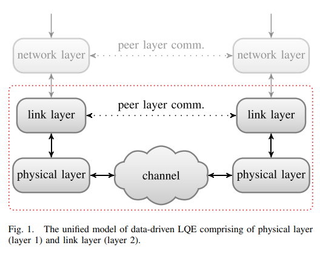
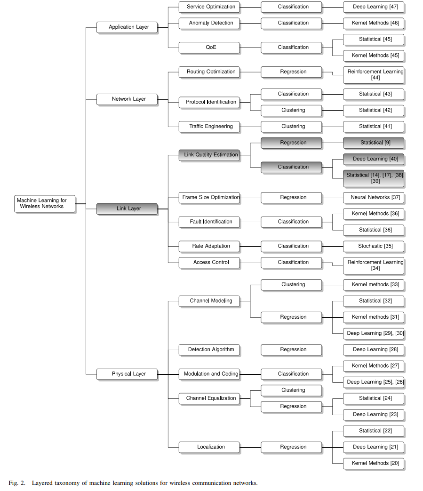
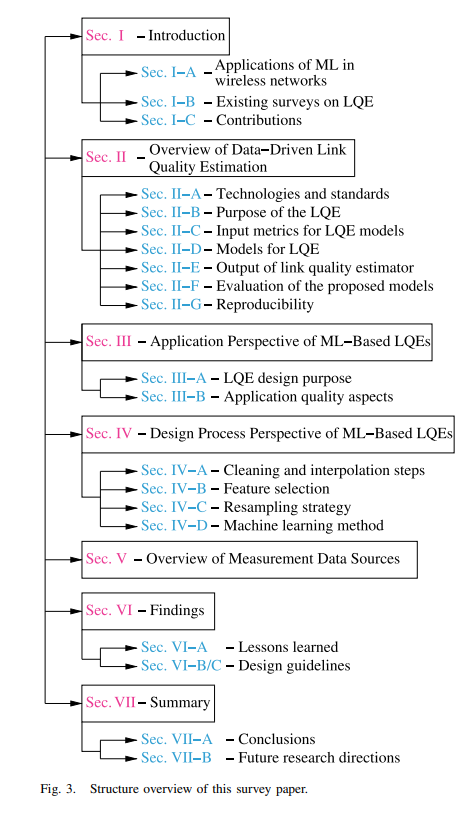
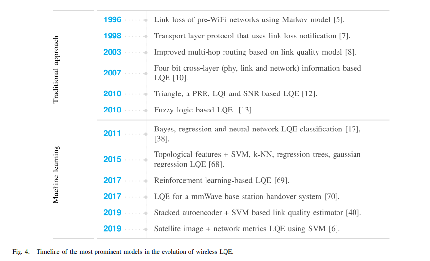
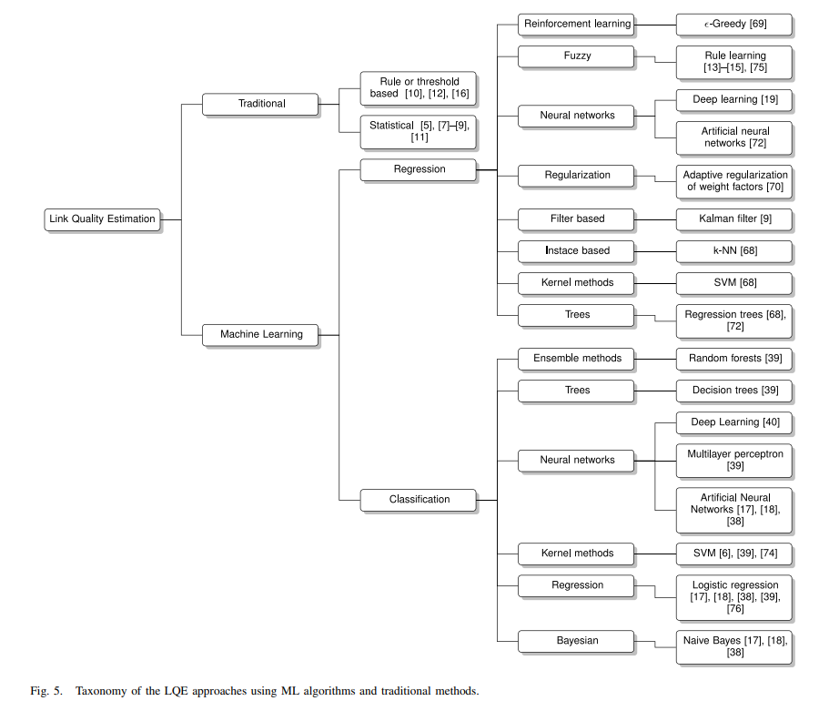
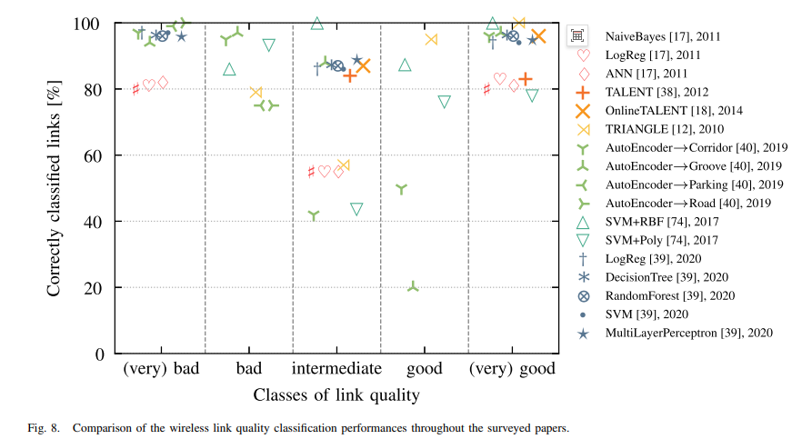
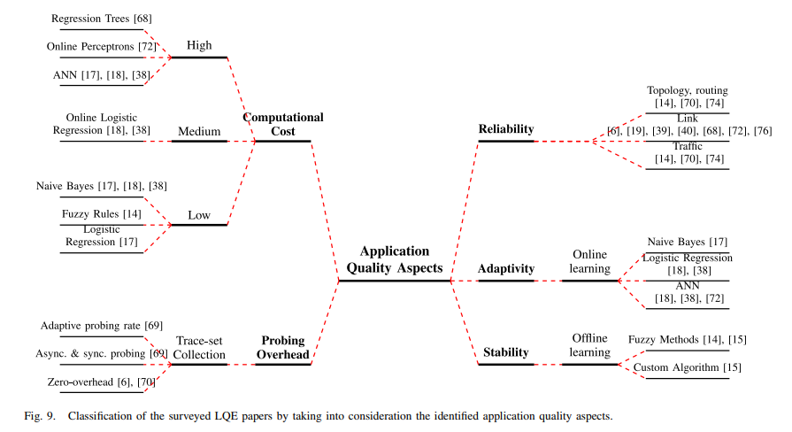
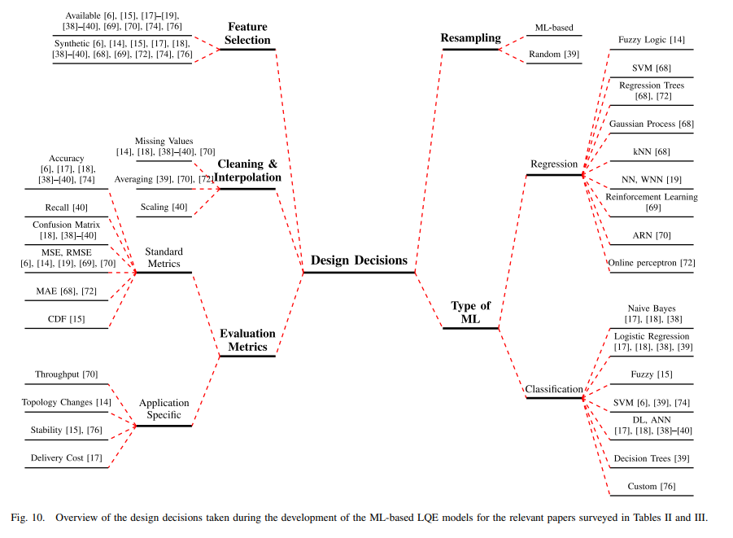
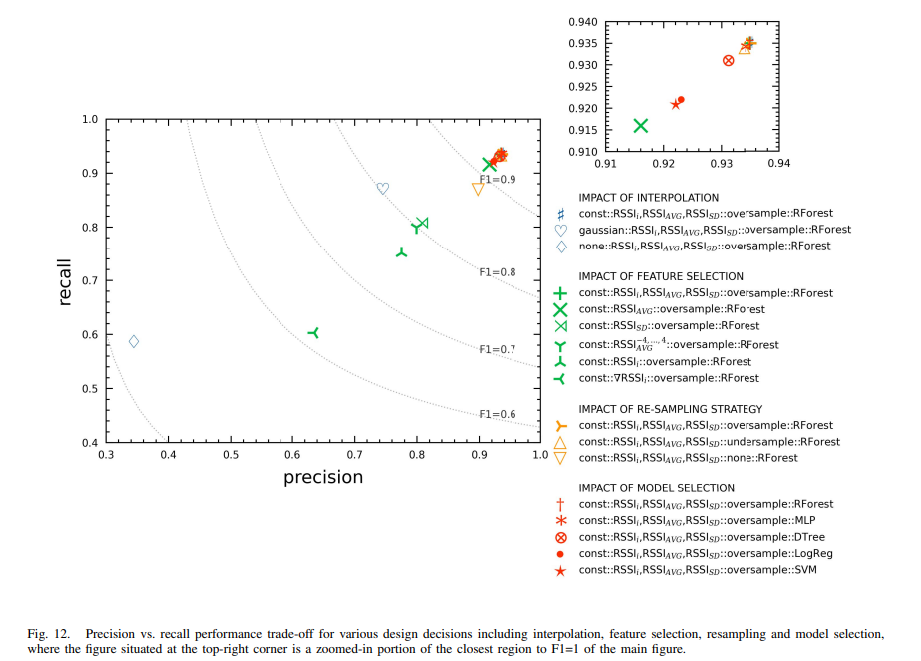
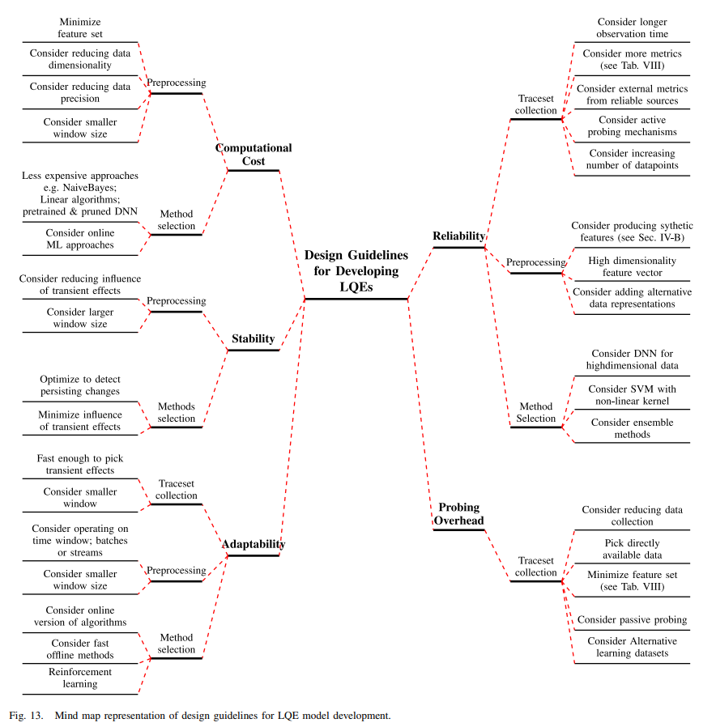
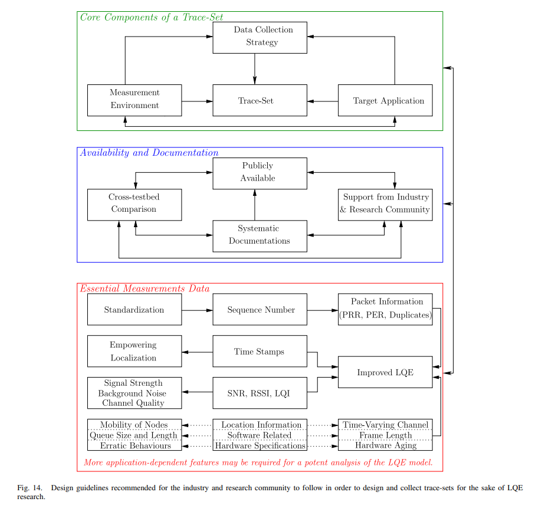

<!-- PAYMENT_BLOCK -->

## Get this dataset

- Payment link (Stripe): [Buy now](https://buy.stripe.com/3cs8yP7sY87d0vu9AB)
- Payment QR code: 

<!-- /PAYMENT_BLOCK -->
